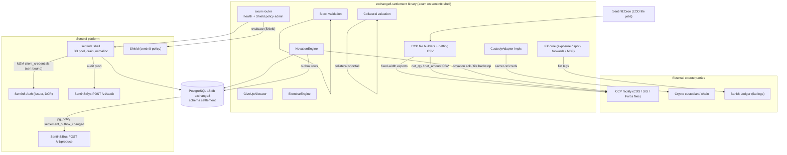

# README.md: Ex8:Settlement

## 1. Summary

Ex8:Settlement is the **external settlement integrations** service of the
exchange8 vertical: novation (the central counterparty substitutes itself for
both original counterparties per trade), custody and collateral for crypto and
fiat rails, give-up/give-in allocation between executing and clearing brokers,
block/EFP/EFR trade reporting validation, FX conversion core (exposure, spot
rails, forwards/NDF), options exercise/assignment/expiry, and CCP
end-of-day file exports (CDS, SIS, Fortis) plus the settlement-netting CSV.
It is a Rust axum binary built on the platform `sentin8::shell` crate
(Sentin8 Shell): registration, DB pool, health, Shield policy-admin mount,
graceful drain.

## 2. Motivation

- The internal trade/position ledger (Ex8:Clearing) and the external
  settlement integrations have fundamentally different failure models —
  deterministic event-sourced math on one side, external I/O with retry,
  ack/reconciliation and per-counterparty deploy cadence on the other. This
  service owns the external side exclusively.
- Real-time novation must be idempotent per trade: a duplicate delivery
  must never double-novate or hand out a second sequence number.
- Crypto custody requires an adapter boundary so private keys remain
  **secret references** (never in-process, never in a database row) and
  every movement is deduplicated by `tx_ref`.
- CCPs consume fixed-width EOD files (CDS 3-record layout, SIS, Fortis)
  whose field widths are pinned to the host struct definitions; drift is
  a reconciliation failure, so the builders are table-driven and
  length-tested.
- FX settlement legs must be produced exactly once per dealt trade, with
  per-currency and per-value-date exposure limits enforced pre-trade.
- Options expiry must auto-exercise in-the-money longs, assign shorts
  (pro-rata or random) and settle cash or physical — deterministically and
  idempotently.

## 3. Architecture & High-Level Design

The service is a Sentin8 Shell binary. The binary wires the HTTP/TLS surface
(health, `/openapi.json`, the Shield policy-admin API) and the platform data
paths; the domain logic lives in pure-core sibling modules that the shell
drives:

| Module | Responsibility |
|---|---|
| `settlement.rs` | Novation engine (idempotent per `trade_id`), collateral valuation (haircut + concentration), give-up allocator, block-trade report validation |
| `ccp_files.rs` | CDS fixed-width file builder (transmission/batch headers + 3-record groups + trailers), SIS and Fortis EOD builders, settlement-netting CSV |
| `fx_core.rs` | Currency-exposure ledger with value-date buckets and limits, spot settlement legs (T+0/T+1/T+2), FX-swap rolls, forward and NDF settlement |
| `crypto_ext.rs` | Crypto precision semantics (×10⁸ scale pairs), continuous 24/7 market mode, `CustodyAdapter` trait + reference impl, atomic settlement-batch gate, withdrawal step-up/limits, fiat/crypto margin rails |
| `options.rs` | Exercise/assignment/expiry engine (European/American, cash/physical, pro-rata/random assignment) |
| `registration.rs` | Self-registration: Shield policy set, PG role, admin scopes, error codes, RFW admin pages, M2M DCR grants, SQL init migration |

Persistence follows the platform DBX pattern: **every domain write inserts a
`settlement.outbox` row in the same transaction**; the shell relay pushes it
to Sentin8:Bus `POST /v1/produce` (`idempotency_key` = outbox row id), and the
audit pusher drains `settlement.audit_journal` to Sentin8:Sys
`POST /v1/audit` (`sentin8:sys:audit:write`).

## 4. Key Traits and Data Structures

Pure cores; no pasted signatures — the concepts:

- **Novation (`NovationEngine`)** — replaces both original counterparties with
  the CCP. Idempotent per `trade_id`: re-novating returns the original
  `novation_seq`. A dense per-session sequence (1, 2, 3 …) is handed out in
  insertion order. A **pending queue** holds trades recorded while the CCP was
  unavailable; recovery drains it oldest-first.
- **Collateral valuation (`CollateralAccount`)** — per-asset post-haircut
  value (`market_value × (10 000 − haircut_bps) / 10 000`), then a
  concentration cap: the largest bucket's contribution is trimmed to
  `concentration_bps` of the pre-cap total.
- **Give-up allocator (`GiveUpAllocator`)** — validates the
  (executing broker → clearing broker) pair against an approved-pair set and
  a minimum quantity; produces an allocation awaiting acceptance.
- **Block validation (`validate_block`)** — a negotiated trade report is
  `Accepted`, `TooSmall` (below min qty), `OffMarket` (outside the reference
  band) or `Late` (past the reporting deadline).
- **FX conversion core (`CurrencyExposure`, `spot_settlement_legs`,
  `settle_forward`, `settle_ndf`)** — a dealt FX trade maps to signed
  (+base, −quote) client legs; exposure aggregates per
  (currency, value-date bucket) with per-bucket and per-currency-total
  limits; NDFs net to a single quote-currency amount (no delivery).
- **Custody (`CustodyAdapter`)** — the integration contract: secret-ref
  credentials, `apply` (deposit/withdraw outcomes `Applied`, `Insufficient`,
  `Unknown`, `Duplicate`), balance query. `MemoryCustody` is the in-memory
  reference; real impls wrap a custodian API. **Settlement batches**
  (`evaluate_batch`) are atomic: legs are netted per (account, asset) first,
  and a single under-covered deliver leg rejects the whole batch.
- **Withdrawal authorization (`authorize_withdrawal`)** — fresh step-up auth
  required, per-asset minimum and 24 h notional cap.
- **Options exercise (`ExerciseEngine`)** — positions keyed by
  (instrument, account); early exercise American-only and quantity-capped;
  expiry auto-exercises ITM longs above a configurable threshold; shorts are
  assigned **pro-rata (largest-remainder)** or **weighted-random**
  (deterministic xorshift64* seed); cash settlement pays intrinsic value,
  physical settlement converts net positions into underlying delivery
  obligations.
- **CCP files (`CdsFile`, `SisFile`, `FortisFile`, `net_trades`)** —
  fixed-width renderers with pinned field widths (fill helpers
  `fill_alpha`/`fill_numeric`/`fill_decimal`/`fill_time`/`eod_fill_price`);
  the netting CSV reports a `net_qty`/`net_amount` row per participant and
  security (a flat net is still reported) as the reconciliation backstop.

## 5. Rationale, Trade-offs, and Alternatives

- **Split from the clearing ledger.** Novation custody of the platform's own
  ledger stays in Ex8:Clearing (deterministic replay); this service owns
  externally coupled effects whose failures are retried/reconciled rather than
  corrected by re-derivation. A single combined service was rejected: the two
  failure models (re-derivation vs. retry/reconcile) would contaminate one
  codebase and one deploy cadence.
- **In-memory pending queue in the pure core vs persistence-first queue.**
  The pure core uses an in-memory pending queue for the CCP-down path; the
  durable behavior is the `settlement.novation` UNIQUE `(env_id, trade_id)`
  row plus the event relay — the shell persists the sequence with the row, so
  recovery is replay-safe even though the core's set is volatile (see
  `DESIGN.md` §6).
- **Atomic batches instead of per-leg settlement (crypto).** All-or-nothing
  batching prevents a partially applied multi-leg move (e.g. receive of one
  leg without the deliver of the other). Rejected alternative: per-leg
  settlement with compensating reversals — more complex and racy under
  concurrent withdrawals.
- **Largest-remainder pro-rata vs pure float allocation.** Integer
  largest-remainder keeps assignment sums exact and total-assignment
  conservation provable; float splitting would leak rounding dust across
  accounts.
- **Fixed-width fill helpers over format! templates per record.** Field
  widths are pinned once in the builders and asserted by length tests
  against the host struct tables; a hand-maintained format string per record
  would drift silently.
- **Secrets by reference everywhere.** Custody credentials, CCP file
  credentials and private keys are `*_secret_ref` columns and
  `creds_secret_ref()` returns; plaintext keys in process memory or SQL rows
  are rejected by design.

## 6. Internal Implementation & Invariants (Private Design)

- Novation sequence numbering is dense from 1 per engine session; the
  persisted `novated_at`/`novation_seq` pair in `settlement.novation` is the
  durable record, and the UNIQUE constraint is the idempotency backstop
  against relay retries producing double novation.
- The pending-queue drain (`novate_pending`) re-enters `novate`, so already
  novated trades collapse to their original result — recovery is safe to
  re-run.
- `checked_notional_same_scale` accepts only the instrument-consistent
  scale pairs — equity `(4, 0)` and crypto `(8, 8)`; any other mix returns
  `None` instead of producing a silently wrong notional.
- `MemoryCustody` records `tx_ref` before the balance check, so a replay of
  the same movement returns `Duplicate` even if the first application
  failed on funds — retries never double-apply or partially apply.
- `evaluate_batch` nets legs per (account, asset) inside the batch before
  checking custody balances; intra-batch offsetting must never require
  external funds.
- The CDS record widths are pinned from the host struct definitions
  (`CDSRecord1/2/3`): record 1 = 80 B, records 2 and 3 = 81 B (+ LF each);
  the SIS/Fortis common record is 259 B (+ `#` + LF; only the final reserved
  block differs: SIS carries `settlmntTyp='0'` + 29 reserved spaces, Fortis
  carries 38 reserved spaces). Numeric fill truncates from the **left**
  (fixed-width field semantics), prices render `%0*.*f` with every decimal
  printed.
- Options: expiry snapshots positions before exercising (physical delivery
  derives from the pre-exercise net position); the contract leaves the
  `Settled` set and its positions are purged from the engine. Random
  assignment draws are weighted by short quantity and conserve the exercised
  total exactly.

## 7. Unresolved Questions / Future Designs

- The HTTP surface today carries health, `/openapi.json` and the Shield
  policy-admin API; the RFW admin pages declared in registration
  (`novation`, `custody`, `collateral`, `blocks`) do not yet have mounted
  data/UI handlers in this binary.
- Domain event emission (novation, custody movements, FX legs, exercise and
  assignment outcomes) via the `settlement.outbox` producer path is designed
  but not yet wired into handlers.
- CCP session scheduling (file jobs on Sentin8:Cron, export transport to the
  facility) and the corporate-action settlement flow are vertical-design
  topics not yet implemented in this unit.
- Real `CustodyAdapter` implementations (custodian API, chain signer) — the
  in-memory reference is the only impl in-tree.
- See `DESIGN.md` §10 for the full list.

---

**Design attribution:** exchange8:settlement and its underlying concepts were designed by Hamid Jahanzad <Hamid@Jahanzad.com>.
